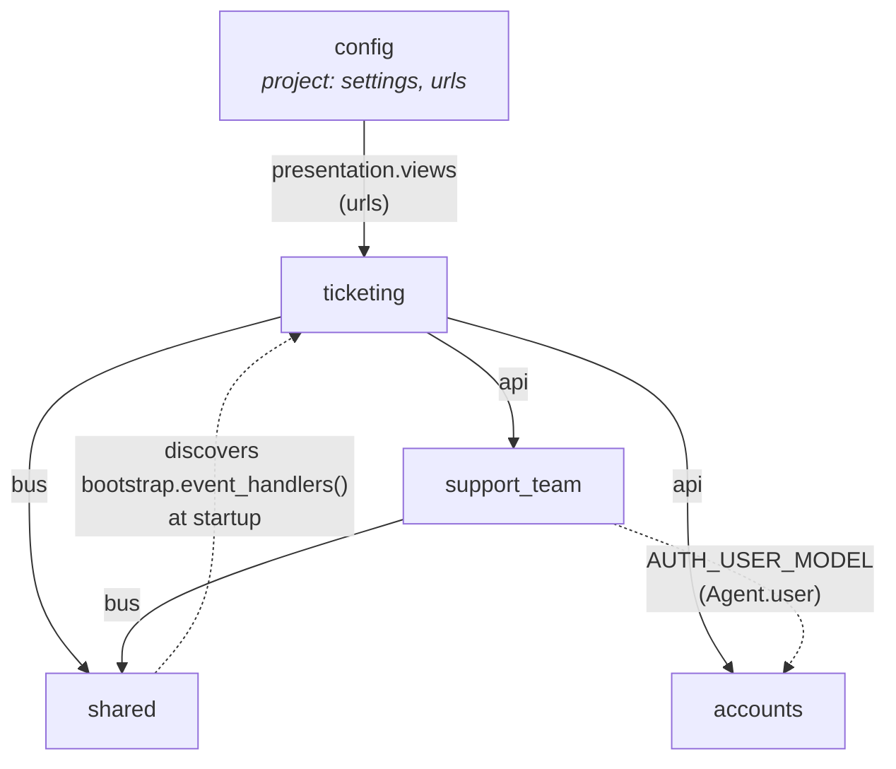

# Helpdesk — a Django modular monolith

```sh
uv sync
uv run python manage.py migrate
uv run python manage.py seed_demo          # users: maria (manager), alice, bob (agents), carol, dave (customers) — password "demo"
uv run python manage.py runserver           # http://127.0.0.1:8888 (override with DJANGO_PORT=xxxx)
uv run python manage.py run_ticket_policies  # schedule every minute (cron/systemd timer): auto-close & auto-reassign

uv run pytest          # tests
uv run lint-imports    # architecture rules
```

## Modules

| Module | Responsibility | Style |
|---|---|---|
| `shared` | Event bus (shared kernel, depends on no module) | Plain Python |
| `accounts` | Users (UUID identities) | Django Active Record |
| `support_team` | Agents, managers, availability | Django Active Record |
| `ticketing` | Support ticket lifecycle | **Domain Model** (layered) |

### Dependencies

These are the imports between modules, taken from the import statements of the source code (tests and migrations
excluded). Solid arrows are imports. Dotted arrows are dependencies with no import statement.



- `ticketing` depends on the other modules only through their `api.py`. Only its `infrastructure` layer and
  `bootstrap.py` import them; its `domain` and `application` layers import no other module.
- No module imports `ticketing`. Only the project does, to mount its URLs. `support_team` reaches ticketing only
  through the `AgentSuspended` event.
- `shared` imports no module. It finds their handlers at runtime, so the dependency points one way in the code only.

Modules only talk to each other through their `api.py` (plain DTOs, never models) and refer to each
other's entities by UUID, without cross-module foreign keys. `import-linter` enforces these rules (see `pyproject.toml`).

### Events

All events go through one in-process bus (`modules/shared/bus.py`), and are delivered once the transaction commits.
A failing handler is logged without affecting the others.

- **A handler declares the event it handles through its type hint.** There is no mapping to maintain:
  `def __call__(self, event: TicketOpened)`, or `event: TicketOpened | TicketClosed` for several events.
- **Handlers are discovered automatically.** At startup, `modules.shared` subscribes the handlers returned by every
  module's `bootstrap.event_handlers()`. Each module still builds its handlers explicitly there, with their
  dependencies. To add a handler, write it and append it to that list.
- A module can subscribe to another module's **integration events**: the events that module exposes in its `api.py`.
  Its domain events stay private, and import-linter enforces that.

Example: when a manager suspends an agent (admin action "Suspend selected agents"):

1. `support_team.api.suspend_agent()` publishes `AgentSuspended`.
2. `ticketing.infrastructure.subscribers.HandOverTicketsOfSuspendedAgent` handles it, because its parameter is typed
   `support_team.AgentSuspended`. It hands the agent's open tickets over to other agents, one transaction per ticket.
3. Each `TicketReassigned` domain event emails the new agent (`NotifyAgentOfReassignedTicket`).

`support_team` never imports `ticketing`.

## Ticketing layers

```
presentation/    views, forms, templates      → calls application, reads via infrastructure.queries
infrastructure/  plain SQL access, repository (Data Mapper), adapters, read-side queries
application/     TicketingService (one use case = one transaction), ports (Clock, AgentDirectory…)
domain/          Ticket aggregate, SLA rules, events, exceptions, repository interface — pure Python
bootstrap.py     composition root
```

- The `Ticket` aggregate holds **every** business rule. Time is passed in as `now`, so the rules are deterministic and
  tested without a database (`tests/test_domain.py`).
- Ticketing has no Django model: its tables are created by a `RunSQL` migration, and `DjangoTicketRepository` hydrates
  the aggregate from plain SQL. It uses optimistic locking (`version`) and inserts messages append-only.
- The aggregate records domain events, which `BusEventPublisher` puts on the bus. Their handlers
  (`application/handlers.py`) only use ports: e.g. `NotifyAgentOfNewTicket` emails the assigned agent through the
  `EmailSender` port (printed to the console in development). Delivery is in-process and best effort; an outbox can
  be plugged in behind the bus later.

## Interpretation of the requirements

- SLA by priority: low 24h, medium 8h, high 4h, urgent 1h (`domain/sla.py`). The clock starts at the first unanswered
  customer message, and any agent message counts as the agent's response.
- Escalation is possible once the response deadline has passed. The agent then gets a fresh window of 67% of the limit,
  counted from the escalation.
- "Opening" an escalated ticket means the assigned agent views its page. Otherwise, after 50% of the reduced limit,
  the ticket is reassigned to another available agent, who gets a new window of their own.
- Any agent message awaiting a reply counts as "a question": with no customer reply for 7 days, the ticket closes,
  unless it is escalated.
- A customer may close at any time. The agent may close unless the ticket is escalated. The agent's manager may always close.
- Reopening (by the customer, within 7 days) starts a fresh cycle and clears the escalation.
